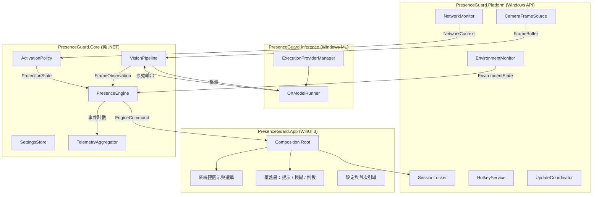
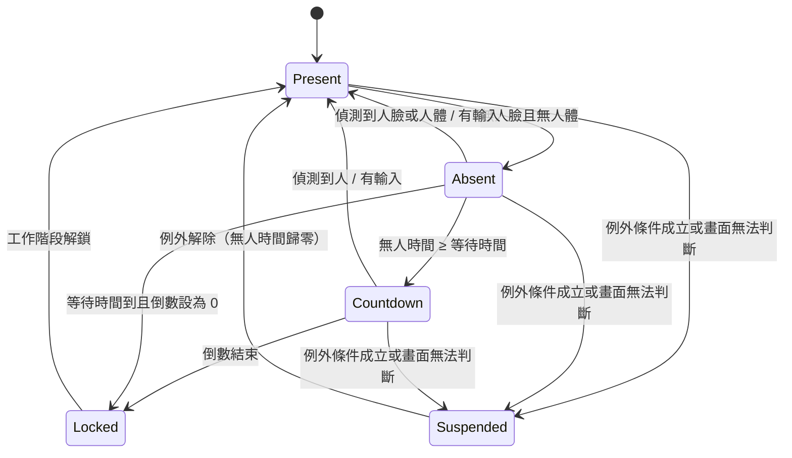
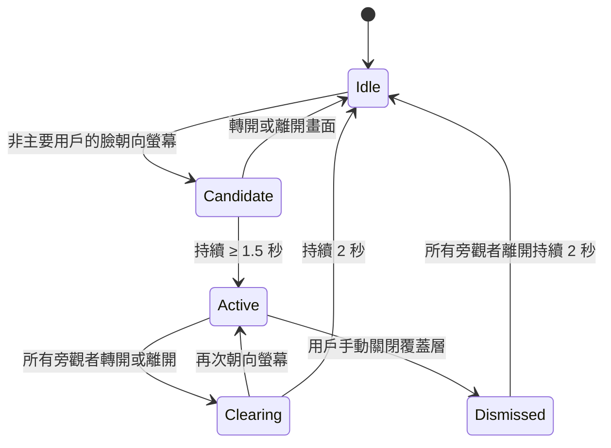

# Design Document

## Overview

Presence Guard V1 是一個常駐系統匣的 Windows 封裝型桌面 App。它以共享唯讀模式讀取前置鏡頭，在 NPU 上執行人臉與人體偵測，把每個影格化約成一筆不含影像的「觀測值」，再由兩個純邏輯的狀態機（防窺、離開偵測）決定要顯示提示、倒數或鎖定。

### 關鍵設計決定

| 決定 | 選擇 | 理由 |
|---|---|---|
| 推論 runtime | Windows ML 2.x（`Microsoft.Windows.AI.MachineLearning`） | 三家 NPU 的 execution provider 由 Windows 下載與更新，App 封裝不含廠商函式庫 |
| EP 選擇 | 明確列舉 NPU 裝置，停用 CPU fallback | Requirement 15.1 要求全部在 NPU 上跑；device policy 會默默退回 CPU |
| 行程模型 | V1 單一行程，核心邏輯獨立成不依賴 UI 的函式庫 | 實作最少；記憶體若超標，可拆成 Agent + UI 兩個行程而不改核心 |
| 核心邏輯 | 純 .NET 函式庫，無 Windows 相依 | 可在 macOS 與 CI 上跑單元測試與重播測試（Requirement 19.3） |
| 模型串接 | 級聯：人臉偵測每次都跑；人體偵測只在無人臉時跑；頭部姿態只算非主要用戶 | 穩定狀態下每個週期只跑一個小模型 |
| 頭部姿態 | V1 由人臉偵測器的 5 點關鍵點幾何推算，不另用模型 | 省一個模型；判定門檻很粗（是否大致朝向螢幕），不需精確角度 |
| 輸入偵測 | 輪詢 `GetLastInputInfo`，不裝鍵盤滑鼠 hook | 只取得「最後輸入時間」，無從記錄按鍵內容（Requirement 7.7） |
| 信任網路辨識 | 只用 SSID | BSSID 需要定位權限，與隱私訊息衝突（見研究發現 3） |
| 簽章 | 向公開 CA 購買 OV 憑證，私鑰放雲端 HSM | Azure Artifact Signing 不開放台灣主體（見研究發現 2） |

### 平台基準

- Windows 11 24H2（build 26100）以上。這是 Windows ML 動態下載 EP 的最低版本。
- .NET 10（LTS）、Windows App SDK 與 Windows ML 2.x 的最新穩定版，實作時鎖定確切版號。
- 建置目標：x64 與 ARM64。

## 研究發現

以下是設計階段查證後會影響設計的事實。標示「需實機驗證」者，代表文件未明確記載，需在 Intel 機器到貨後確認。

### 1. Windows ML 的 EP 管理與 NPU 指定

- `ExecutionProviderCatalog.GetDefault().FindAllProviders()` 列出裝置相容的 EP，每個 EP 有 `ReadyState`（`NotPresent` / `NotReady` / `Ready`）。`EnsureReadyAsync()` 下載並安裝，支援進度回呼；`TryRegister()` 向 ONNX Runtime 註冊。[來源](https://learn.microsoft.com/en-us/windows/ai/new-windows-ml/initialize-execution-providers)
- 指定 NPU 的做法是 `OrtEnv.GetEpDevices()` 後以 `HardwareDevice.Type == OrtHardwareDeviceType.NPU` 過濾，再 `SessionOptions.AppendExecutionProvider(env, devices, options)`。Microsoft 建議先用明確選擇以取得可預測的結果。文件也警告 EP 裝置清單會在執行期因 EP 或驅動更新而改變。[來源](https://learn.microsoft.com/en-us/windows/ai/new-windows-ml/select-execution-providers)
- EP 名稱：`OpenVINOExecutionProvider`、`QNNExecutionProvider`、`VitisAIExecutionProvider`。動態下載需要 Windows 11 24H2（build 26100）以上。[來源](https://learn.microsoft.com/en-us/windows/ai/new-windows-ml/supported-execution-providers)
- 同一頁列出的硬體限制值得注意：QNN 目前只列 Snapdragon X Elite / X Plus；VitisAI 同時有最低與**最高**驅動版本。補 Qualcomm 與 AMD 機器時需重新確認。

### 2. 程式碼簽章

- Azure Artifact Signing（原 Trusted Signing）的 Public Trust 憑證只開放美國、加拿大、歐盟、英國、澳洲、紐西蘭、日本、南韓、新加坡、瑞士、挪威、以色列的組織。**台灣不在名單內。**[來源](https://learn.microsoft.com/en-us/azure/artifact-signing/quickstart)
- SmartScreen 信譽自 2024 年起不再因 EV 憑證而立即取得，改為隨時間累積；以同一簽章身分持續發布可以延續信譽。[來源](https://learn.microsoft.com/en-us/windows/apps/package-and-deploy/distribution-feature-status)
- 結論：買 OV 憑證即可，EV 沒有額外好處。新產品上市初期用戶下載時仍可能看到 SmartScreen 提示。

### 3. Wi-Fi 資訊與定位權限

- Windows 11 24H2 起，涉及 BSSID 的 Wi-Fi API（`WlanQueryInterface` 查目前連線、`WlanGetAvailableNetworkList`、`Windows.Devices.WiFi` 等）需要用戶授予精確位置權限，否則回傳拒絕存取。
- Microsoft 明確指出：只需要 SSID 的 App 可以改用 `WlanConnectionProfileDetails.GetConnectedSsid`。[來源](https://learn.microsoft.com/en-us/windows/win32/nativewifi/wi-fi-access-location-changes)
- 結論：V1 只用 SSID，不要求定位權限。`GetConnectedSsid` 在封裝型桌面 App 中是否需要額外 capability，需實機驗證。

### 4. 鏡頭共享

- `MediaCaptureSharingMode.SharedReadOnly` 可在其他 App 使用鏡頭時讀取影格，但不能調整鏡頭設定。若其他 App 以獨占模式持有鏡頭，初始化會失敗。[來源](https://learn.microsoft.com/en-us/uwp/api/windows.media.capture.mediacapturesharingmode)
- 有開發者回報在 WinUI 3 App 以 SharedReadOnly 與 Teams 並存時畫面異常。[來源](https://static.codeproject.com/Questions/5387164/answer) 屬單一案例，但表示與各通話軟體的共存必須逐一實測。
- 共享唯讀模式下無法選擇低解析度或低幀率格式，鏡頭感測器的耗電不受我們控制。這是 Requirement 15.4 的主要風險，見「風險與待決事項」第 1 項。

### 5. MSIX 官網發布與自動更新

- `ms-appinstaller:` 協定自 2023 年 12 月起預設停用。目前建議做法是直接連結 `.appinstaller` 檔，用戶下載後雙擊安裝。[來源](https://learn.microsoft.com/en-us/windows/apps/package-and-deploy/distribution-feature-status)
- `ShowPrompt`、`UpdateBlocksActivation`、`HoursBetweenUpdateChecks` 需要 2021 版 schema；Visual Studio 預設產生 2017/2 版，設定會被靜默忽略。[來源](https://learn.microsoft.com/en-us/windows/msix/app-installer/auto-update-and-repair--overview)
- 常駐 App 不會自然關閉，因此不能只靠「啟動時檢查更新」。設計上需由 App 主動偵測更新並在安全時機重啟（見 `UpdateCoordinator`）。

### 6. 系統狀態偵測

- `CallNtPowerInformation(SystemExecutionState)` 回傳系統目前的執行狀態旗標，包含 `ES_DISPLAY_REQUIRED`。[來源](https://learn.microsoft.com/en-us/windows/win32/api/powerbase/nf-powerbase-callntpowerinformation) 是否需要提升權限，文件未載明，需實機驗證。
- 「其他 App 正在使用鏡頭」沒有公開 API。常見做法是讀取登錄檔 `HKCU\...\CapabilityAccessManager\ConsentStore\webcam` 下各 App 的 `LastUsedTimeStart` / `LastUsedTimeStop`，但這是未公開的實作細節。[來源](https://docs.velociraptor.app/exchange/artifacts/pages/windows.registry.capabilityaccessmanager)

### 7. 候選模型

- YuNet 人臉偵測（OpenCV Zoo）：MIT 授權，輸出邊界框與 5 個關鍵點（雙眼、鼻尖、兩個嘴角）。2023mar 版為固定 640×640 輸入，並有 INT8 量化版本流通。[來源](https://huggingface.co/pollen-robotics/face_detection_yunet_2023mar)
- 人體偵測候選：YOLOX-Nano、NanoDet-Plus（皆為 Apache-2.0 程式碼）。兩者的權重授權與 NPU 算子覆蓋率尚未查證，選型留待實機評估。

## Architecture

### 分層



相依方向一律由外向內：`App → Platform / Inference → Core`。`Core` 不引用任何 Windows 型別。

### 專案結構

```
src/
  PresenceGuard.Core/          net10.0          領域模型、狀態機、前後處理、設定、遙測聚合
  PresenceGuard.Inference/     net10.0-windows  Windows ML EP 管理、ONNX session
  PresenceGuard.Platform/      net10.0-windows  鏡頭、鎖定、網路、電源、快捷鍵、更新
  PresenceGuard.App/           WinUI 3          系統匣、覆蓋層、設定、引導、MSIX 資訊清單
tests/
  PresenceGuard.Core.Tests/        單元測試（可在 macOS / Linux 執行）
  PresenceGuard.Replay.Tests/      以錄製的觀測值重播，計算驗收指標
  PresenceGuard.Device.Tests/      需要實機 NPU 的測試（self-hosted runner）
models/
  manifest.json                模型清單與授權紀錄
  *.onnx
tools/
  convert/                     Python：ONNX 轉檔、量化、精度比對
  recorder/                    錄製觀測值追蹤檔的開發工具
.github/workflows/
```

### 資料流（單一推論週期）

1. `CameraFrameSource` 依 `FrameRatePolicy` 指定的間隔取出最新影格，其餘影格直接丟棄。
2. 影格轉成 `FrameBuffer`（BGR 位元組）。`FrameQualityGate` 計算平均亮度與變異數；若判定過暗或全黑，產生 `Quality = TooDark` 的觀測值並跳過推論。
3. `VisionPipeline` 執行人臉偵測。若人臉數為 0，執行人體偵測。若有非主要用戶的人臉，由其關鍵點推算頭部姿態。
4. `FrameBuffer` 歸還緩衝池並清零。往下游傳遞的只有 `FrameObservation`。
5. `PresenceEngine.Step()` 以觀測值、環境狀態、輸入閒置時間與目前設定為輸入，輸出一組 `EngineCommand`。
6. Composition Root 把命令分派給覆蓋層、鎖定服務與系統匣。

### 執行緒模型

- 鏡頭回呼執行緒只把最新影格放進容量為 1 的通道，舊影格被覆蓋（Requirement 15.7）。
- 一條專用的推論執行緒依序完成步驟 2–5，因此狀態機不需要鎖。
- UI 更新透過 `DispatcherQueue` 送回 UI 執行緒。
- 倒數期間另以 100 ms 週期輪詢輸入閒置時間，使取消的反應不受推論幀率限制。

## Components and Interfaces

### Core

#### 領域模型

```csharp
public readonly record struct RectF(float X, float Y, float Width, float Height);
public readonly record struct HeadPose(float YawDeg, float PitchDeg);

public readonly record struct FaceObservation(
    int TrackId, RectF Box, float Score, HeadPose? Pose);

public enum FrameQuality { Ok, TooDark, Unavailable }

public sealed record FrameObservation(
    TimeSpan Timestamp,
    FrameQuality Quality,
    IReadOnlyList<FaceObservation> Faces,
    bool BodyPresent);
```

`FrameObservation` 是整個系統中唯一跨越視覺管線邊界的資料，不含任何像素，也不含可辨識身分的特徵（Requirement 3.3、3.4）。

#### 抽象介面

```csharp
// Requirement 19.1：鏡頭以外的來源（螢幕擷取、圖檔）之後實作同一介面
public interface IFrameSource : IAsyncDisposable
{
    FrameSourceStatus Status { get; }
    event Action<FrameSourceStatus> StatusChanged;
    Task StartAsync(CancellationToken ct);
    Task StopAsync();
    bool TryTakeLatest(out FrameBuffer frame);
}

// Requirement 19.2：模型可替換
public interface IModelRunner : IDisposable
{
    ModelSpec Spec { get; }
    void Run(ReadOnlySpan<float> input, IModelOutputSink outputs);
}

public interface IFaceDetector  { IReadOnlyList<RawFace> Detect(FrameBuffer frame); }
public interface IBodyDetector  { bool Detect(FrameBuffer frame); }
public interface IHeadPoseEstimator { HeadPose? Estimate(RawFace face, int frameW, int frameH); }

public interface IClock { TimeSpan Now { get; } }
```

`IHeadPoseEstimator` 在 V1 的實作是 `LandmarkHeadPoseEstimator`（純幾何）。若實測準確度不足，可換成以模型為基礎的實作而不動 `PresenceEngine`。

#### VisionPipeline

- 以 `ModelSpec`（來自 `models/manifest.json`）決定輸入尺寸、色彩順序、正規化參數與輸出解碼方式（Requirement 19.4）。
- 前處理：letterbox 縮放到固定輸入尺寸。後處理：解碼、NMS、座標還原。這些都是純函式，可單元測試。
- `FaceTracker`：以 IoU 比對跨影格的人臉並指派 `TrackId`。
- 主要用戶選擇：無主要用戶時取面積最大者；之後維持同一 `TrackId`，直到該軌跡消失超過追蹤容忍時間（預設 1 秒）才重新選擇（Requirement 4.2、4.3）。

#### LandmarkHeadPoseEstimator

由 5 個關鍵點估算：

- **yaw**：鼻尖相對於雙眼中點的水平偏移，除以雙眼間距。
- **pitch**：鼻尖在「雙眼連線」與「嘴角連線」之間的垂直位置比例。

人臉邊長小於門檻（預設 24 像素）時回傳 `null`，該人臉不參與防窺判定（Requirement 5.7）。「朝向螢幕」定義為 |yaw| 與 |pitch| 都小於設定的角度（預設各 30° 與 25°）。這些門檻由重播測試調校。

#### PresenceEngine

純邏輯、無 I/O、可決定性重播。

```csharp
public sealed record EngineInput(
    FrameObservation? Observation,      // 本週期沒有新影格時為 null
    TimeSpan Now,
    TimeSpan IdleTime,                  // 距離最後一次鍵鼠輸入
    EnvironmentState Environment,
    ProtectionState Protection,
    UserSettings Settings);

public abstract record EngineCommand
{
    public sealed record ShowPeekHint : EngineCommand;
    public sealed record ShowPrivacyCover : EngineCommand;
    public sealed record HideOverlays : EngineCommand;
    public sealed record StartCountdown(int Seconds) : EngineCommand;
    public sealed record CancelCountdown : EngineCommand;
    public sealed record LockSession(LockReason Reason) : EngineCommand;
    public sealed record SetFrameRate(FrameRateLevel Level) : EngineCommand;
    public sealed record ReportStatus(GuardStatus Status) : EngineCommand;
}

public sealed class PresenceEngine
{
    public IReadOnlyList<EngineCommand> Step(EngineInput input);
    public void NotifyCoverDismissed();   // Requirement 6.7
}
```

內含兩個獨立狀態機，共用同一份輸入。

**離開偵測狀態機**



規則：

- 「有人」＝ `Faces.Count > 0 || BodyPresent`（Requirement 7.6）。
- `Quality != Ok` 一律進入 `Suspended`，絕不視為無人（Requirement 9.8）。
- `Suspended` 的觸發條件：簡報或全螢幕、通話中；另外當設定 `KeepUnlockedWhenDisplayRequired` 開啟時，「顯示器保持開啟」也會觸發（Requirement 9.4、9.5、9.9）。
- 輸入的判定方式：`IdleTime` 小於距上次 `Step` 的時間間隔。

**防窺狀態機**



規則：

- 沒有主要用戶時維持 `Idle`（Requirement 5.6）。
- 持續時間以 `TrackId` 為單位各自累計，避免不同路人的短暫出現被加總。
- 進入 `Active` 時依設定的反應等級發出 `ShowPeekHint`、`ShowPrivacyCover` 或 `LockSession`。
- 離開偵測處於 `Suspended` 時，防窺仍照常運作（Requirement 9.7）；但 `Quality != Ok` 時兩者都暫停。

#### FrameRatePolicy

| 等級 | 幀率 | 觸發條件 |
|---|---|---|
| Idle | 1 fps | 主要用戶在座、無其他人臉、狀態持續穩定超過 10 秒；或系統處於省電模式 |
| Normal | 2 fps | 預設 |
| Elevated | 8 fps | 人臉數量變化、主要用戶消失、處於 `Absent` / `Countdown` / `Candidate` / `Active` |

幀率值為起始假設，以實測功耗調整。

#### ActivationPolicy

決定保護是否啟用，輸入為手動覆寫、網路情境、暫停計時與設定。

```csharp
public enum ManualOverride { Auto, ForcedOn, ForcedOff }

public enum ProtectionState { Disabled, Active, Paused }

public enum PauseReason
{
    None, UserPause, CameraBlocked, CameraUnavailable,
    LidClosed, SessionLocked, EpUnavailable
}
```

判定順序：

1. 工作階段鎖定、闔蓋、鏡頭不可用、EP 不可用 → `Paused`（附原因）。
2. 用戶暫停計時未到期 → `Paused(UserPause)`。
3. `ForcedOn` → `Active`；`ForcedOff` → `Disabled`。
4. `Auto`：自動啟用關閉 → `Disabled`；網路為信任 → `Disabled`；否則 → `Active`。

`ForcedOff` 在網路情境改變時重設為 `Auto`（Requirement 12.3）；`ForcedOn` 不受網路影響（Requirement 12.2）。

網路信任判定：

| 連線狀態 | 判定 |
|---|---|
| 無任何連線 | 非信任 |
| 只有有線網路 | 信任 |
| Wi-Fi，SSID 在信任清單中 | 信任 |
| Wi-Fi，SSID 不在清單中 | 非信任 |
| Wi-Fi 與有線同時連線 | 依 Wi-Fi 的 SSID 判定 |

#### SettingsStore

- 以 JSON 儲存在封裝 App 的本機資料夾（`ApplicationData.Current.LocalFolder`）。解除安裝時系統會一併移除，滿足 Requirement 18.7。
- 載入時逐欄驗證範圍；檔案損毀時改名備份、以預設值啟動並通知（Requirement 14.4）。
- 變更時發出事件，各元件即時套用（Requirement 14.2）。

#### TelemetryAggregator

- 只在記憶體中累計計數器與延遲直方圖，每日至多送出一批。
- 不產生安裝 ID 或裝置 ID；每批資料彼此無法關聯（Requirement 17.4）。
- 透過 `ITelemetrySink` 送出。遙測關閉時注入空實作，確保沒有任何網路呼叫（Requirement 17.2）。
- 欄位以白名單型別定義（`TelemetryBatch` record），不接受任意字串，從型別上排除誤傳 SSID 或路徑的可能。

### Inference

#### ExecutionProviderManager

```csharp
public enum NpuAvailability { Ready, NeedsDownload, NotSupported, Failed }

public interface IExecutionProviderManager
{
    Task<NpuAvailability> ProbeAsync();
    Task<bool> EnsureReadyAsync(IProgress<double> progress, CancellationToken ct);
    SessionOptions CreateNpuSessionOptions();
}
```

- `ProbeAsync`：以 `FindAllProviders()` 尋找名稱為 `OpenVINOExecutionProvider`、`QNNExecutionProvider` 或 `VitisAIExecutionProvider` 的 EP。都沒有則回傳 `NotSupported`（Requirement 1.2）。
- `EnsureReadyAsync`：對選定的 EP 呼叫 `EnsureReadyAsync()` 並轉送進度，成功後 `TryRegister()`（Requirement 1.3、1.4）。
- `CreateNpuSessionOptions`：從 `GetEpDevices()` 篩出 NPU 裝置並附加；同時設定 `session.disable_cpu_ep_fallback = 1`，使含有 NPU 不支援算子的模型在建立 session 時直接失敗，而不是默默跑在 CPU 上（Requirement 1.4、15.1）。
- 每次建立 session 都重新列舉 EP 裝置，不快取裝置物件。

#### OrtModelRunner

- 啟動時為每個模型建立一個 `InferenceSession` 並重複使用。
- 輸入輸出張量預先配置，推論迴圈中不配置記憶體。
- 記錄每次推論的耗時，供遙測與幀率策略使用。

### Platform

| 元件 | 職責 | 使用的 API |
|---|---|---|
| `CameraFrameSource` | 以共享唯讀模式開啟鏡頭並提供影格 | `MediaCapture`（`SharingMode = SharedReadOnly`、`MemoryPreference = Cpu`）、`MediaFrameReader` |
| `InputIdleMonitor` | 回報距離最後輸入的時間 | `GetLastInputInfo` |
| `SessionLocker` | 鎖定工作階段 | `LockWorkStation` |
| `SessionMonitor` | 偵測鎖定與解鎖 | `WTSRegisterSessionNotification` |
| `LidMonitor` | 偵測闔蓋 | `RegisterPowerSettingNotification`（`GUID_LIDSWITCH_STATE_CHANGE`） |
| `PresentationDetector` | 偵測簡報與全螢幕 | `SHQueryUserNotificationState` |
| `DisplayRequestDetector` | 偵測顯示器保持開啟的要求 | `CallNtPowerInformation(SystemExecutionState)` |
| `CallDetector` | 偵測其他 App 的通話 | WASAPI 擷取端工作階段列舉；`ConsentStore` 登錄檔 |
| `PowerModeMonitor` | 偵測省電模式 | `PowerManager.EnergySaverStatus` |
| `NetworkMonitor` | 回報連線類型與 SSID | `NetworkInformation`、`WlanConnectionProfileDetails.GetConnectedSsid` |
| `HotkeyService` | 全域快捷鍵 | `RegisterHotKey` |
| `StartupService` | 登入時啟動 | 封裝資訊清單的 `windows.startupTask`、`StartupTask` |
| `UpdateCoordinator` | 偵測更新並在安全時機套用 | `Package.CheckUpdateAvailabilityAsync`、`PackageManager` |

補充說明：

**CameraFrameSource**

- 只以 `SharedReadOnly` 初始化。失敗時回報 `Unavailable`，不以獨占模式重試（Requirement 10.3）。
- 不呼叫任何會設定格式或控制項的 API（Requirement 10.4）。訂閱格式變更事件，尺寸改變時重新配置緩衝區（Requirement 10.2）。
- `StopAsync` 會釋放 `MediaCapture`，使指示燈熄滅（Requirement 3.7）。
- 內建鏡頭的辨識：`DeviceInformation.EnclosureLocation` 顯示位於上蓋或正面面板。

**EnvironmentMonitor**

彙整各偵測器，輸出單一的不可變狀態：

```csharp
public sealed record EnvironmentState(
    bool PresentationOrFullScreen,
    bool DisplayRequired,
    bool CallInProgress,
    bool LidClosed,
    bool SessionLocked,
    bool EnergySaver);
```

每個偵測器都在介面之後，失敗時回報「未偵測到」並記錄日誌，不拋出例外。

**CallDetector**

- 麥克風：列舉預設擷取端點的音訊工作階段，若有其他行程的工作階段處於作用中，視為通話中。這是公開 API。
- 鏡頭：讀取 `ConsentStore\webcam` 下各 App 的使用時間戳。這是未公開的做法，因此獨立成一個可關閉的策略，並以實機測試確認其行為。
- 兩者任一成立即回報通話中。排除本 App 自己的項目。

**UpdateCoordinator**

- 每日檢查一次是否有新版本。
- 有新版本時等待「安全時機」：工作階段剛鎖定，或保護處於 `Disabled`。
- 在安全時機登記重新啟動後套用更新。保護啟用中不強制中斷（Requirement 18.3）。
- 所需的 `PackageManager` 用法與封裝 capability，需實機驗證。

### App

#### 系統匣

- WinUI 3 沒有內建的系統匣元件。V1 以 `Shell_NotifyIcon` 的薄包裝實作。
- 四種狀態各有不同形狀的圖示，不只靠顏色區分（Requirement 13.6）。工具提示顯示狀態與原因。
- 自動啟動時不建立主視窗（Requirement 18.5）。

#### 覆蓋層

三種覆蓋視窗都是無邊框、最上層、不搶焦點（`WS_EX_NOACTIVATE | WS_EX_TOOLWINDOW | WS_EX_TOPMOST`）。

| 視窗 | 外觀 | 互動 |
|---|---|---|
| `PeekHintWindow` | 每個顯示器邊緣的細框加角落圖示 | 滑鼠穿透（`WS_EX_TRANSPARENT`） |
| `PrivacyCoverWindow` | 每個顯示器一個全螢幕遮蓋 | 點擊或快捷鍵關閉 |
| `CountdownWindow` | 主顯示器下方置中，顯示秒數與取消方式 | 任何輸入即取消（由引擎判定） |

- `PrivacyCoverWindow` 以不透明底色為基準實作，在系統允許時疊加壓克力材質。不依賴「真正模糊後方內容」，因為壓克力在省電模式或關閉透明效果時會退回純色，而遮蔽效果不能因此失效。
- 覆蓋層顯示時透過 UI Automation 發出通知事件（Requirement 21.5）。
- 顯示器配置改變時重新建立覆蓋視窗。

#### 首次引導

步驟：隱私說明 → 鏡頭授權 → 遙測選擇（預設不同意）→ 信任目前網路 → 完成。完成之前 `CameraFrameSource` 不會被建立（Requirement 2.6）。

鏡頭權限被拒時，顯示說明並提供 `ms-settings:privacy-webcam` 捷徑（Requirement 2.3）。

#### 封裝資訊清單

- Capabilities：`runFullTrust`、`webcam`、`internetClient`。不宣告 `location` 與 `wiFiControl`。
- Extensions：`windows.startupTask`。
- `.appinstaller` 使用 2021 schema，設定 `HoursBetweenUpdateChecks` 與背景更新，`ShowPrompt = false`，`UpdateBlocksActivation = false`。

## Data Models

### UserSettings

```csharp
public sealed record UserSettings
{
    public int SchemaVersion { get; init; } = 1;

    // 功能開關
    public bool AntiPeekEnabled { get; init; } = true;
    public bool WalkAwayEnabled { get; init; } = true;
    public bool AutoActivateOnUntrustedNetwork { get; init; } = true;

    // 離開偵測
    public int AwayDelaySeconds { get; init; } = 15;        // 5–120
    public int CountdownSeconds { get; init; } = 5;         // 0–15
    public bool KeepUnlockedWhenDisplayRequired { get; init; } = false;

    // 防窺
    public PeekReaction PeekReaction { get; init; } = PeekReaction.Hint;

    // 其他
    public int PauseMinutes { get; init; } = 15;            // 1–120
    public bool TelemetryEnabled { get; init; } = false;
    public bool LaunchAtLogin { get; init; } = true;
    public string? CameraDeviceId { get; init; }            // null = 自動選擇前置鏡頭
    public string? Language { get; init; }                  // null = 跟隨系統
    public HotkeyBindings Hotkeys { get; init; } = HotkeyBindings.Default;
    public IReadOnlyList<TrustedNetwork> TrustedNetworks { get; init; } = [];
    public bool OnboardingCompleted { get; init; } = false;
}

public enum PeekReaction { Hint, Cover, Lock }
public sealed record TrustedNetwork(string Ssid, DateTimeOffset AddedAt);
```

### 模型清單（models/manifest.json）

```json
{
  "models": [
    {
      "id": "face-detector",
      "file": "face_det.onnx",
      "sha256": "…",
      "input": { "width": 640, "height": 640, "layout": "NCHW",
                 "color": "BGR", "mean": [0, 0, 0], "scale": 1.0 },
      "decoder": "yunet",
      "precision": "int8-qdq",
      "source": "https://…",
      "codeLicense": "MIT",
      "weightsLicense": "MIT",
      "trainingData": "…",
      "commercialDistribution": true
    }
  ]
}
```

- `sha256` 在載入時驗證。
- `commercialDistribution` 為 `false` 的項目會讓發布建置失敗（Requirement 20.2）。PoC 階段的模型如實標示 `false`，開發建置不受影響。
- 同一份清單用來產生「關於」畫面的授權聲明（Requirement 20.3）。

### 觀測值追蹤檔

開發工具 `recorder` 把每個週期的 `EngineInput` 序列化為 JSON Lines。重播測試讀取追蹤檔、逐筆餵給 `PresenceEngine`，並比對預期的命令序列。追蹤檔不含影像，可以放進版本庫。

### 遙測批次

```csharp
public sealed record TelemetryBatch(
    string AppVersion, string OsBuild, string NpuVendor, string ExecutionProvider,
    LatencyHistogram InferenceLatency,
    double AntiPeekActiveHours, double WalkAwayActiveHours,
    int Locks, int CountdownCancels, int PeekEvents, int CoverDismissals,
    IReadOnlyDictionary<PauseReason, int> PauseCounts);
```

## Error Handling

原則：**無法判斷時暫停保護並告知用戶，不做出鎖定或「安全」的假設。**

| 情境 | 處理 | 用戶看到的狀態 |
|---|---|---|
| 無相容 NPU EP | 停留在不支援畫面，不啟動鏡頭 | 「此裝置不支援」 |
| EP 下載失敗 | 顯示原因與重試；不退回 CPU | 錯誤 + 重試按鈕 |
| 模型含 NPU 不支援的算子 | session 建立失敗；記錄模型 ID 與 EP | 「保護無法啟動」+ 回報指引 |
| 執行期 EP 裝置消失（驅動更新） | 重建 session 一次；再失敗則暫停 | 「保護已暫停：NPU 無法使用」 |
| 鏡頭權限被拒 | 暫停；提供設定捷徑 | 「需要鏡頭權限」 |
| 鏡頭被獨占或開啟失敗 | 暫停；每 30 秒重試一次 | 「保護已暫停：鏡頭無法使用」 |
| 影格全黑或過暗 | 暫停判定 | 「保護已暫停：鏡頭被遮蔽或環境過暗」 |
| 鏡頭格式改變 | 重新配置緩衝區後繼續 | 無 |
| 推論逾時 | 丟棄影格；連續逾時則降低幀率 | 無 |
| `LockWorkStation` 失敗 | 記錄；顯示遮蓋覆蓋層作為後備 | 遮蓋覆蓋層 |
| 快捷鍵註冊失敗 | 該快捷鍵停用並提示衝突 | 設定頁警示 |
| 設定檔損毀 | 備份後以預設值啟動 | 一次性通知 |
| 遙測傳送失敗 | 靜默捨棄 | 無 |
| 環境偵測器失敗 | 視為「未偵測到」；記錄日誌 | 無 |
| 未處理例外 | 寫入日誌；遙測同意時送出當機報告；釋放鏡頭後結束 | 下次啟動時提示 |

### 日誌

- 存於本機資料夾，滾動保留，總量上限 5 MB。
- 只記錄事件類型、時間、狀態轉移與數值。型別上禁止把 `FrameBuffer` 或 SSID 傳入日誌 API（Requirement 3.6）。

## Testing Strategy

### 單元測試（Core，任何平台）

- **狀態機**：以 `FakeClock` 與手寫的 `EngineInput` 序列涵蓋每一條轉移，包含邊界時間（剛好達到門檻、差一個週期）。
- **ActivationPolicy**：手動覆寫 × 網路情境 × 暫停的完整組合表。
- **前後處理**：letterbox 座標還原、NMS、解碼器，以固定張量比對。
- **LandmarkHeadPoseEstimator**：合成的關鍵點配置對應已知角度。
- **SettingsStore**：範圍驗證、損毀復原、版本遷移。
- **TelemetryAggregator**：關閉時零輸出；批次不含識別資訊。
- 覆蓋率目標：Core 達 80% 以上。

### 重播測試

- 輸入：`recorder` 產生的觀測值追蹤檔，涵蓋 Requirement 16.5 列出的條件（口罩、眼鏡、低頭、轉頭、一般照明、背光）與公共場所情境。
- 輸出：誤鎖次數、鎖定延遲分布、防窺檢出率與誤觸發率，直接對應 Requirement 16.1–16.4。
- 門檻值調校在此層進行，不需要實機。

### 模型層測試

- 以 ONNX Runtime 的 CPU EP 執行同一批模型，驗證管線輸出與參考實作一致。可在 CI 上執行。
- 量化前後的精度比對由 `tools/convert` 的 Python 腳本完成，結果記錄在模型清單旁。

### 實機測試（Device.Tests）

- 每個模型在 NPU 上以停用 CPU fallback 的設定成功建立 session。
- 單次推論延遲與各幀率等級下的實際幀率。
- 鏡頭共存：分別在 LINE、Teams、Zoom、瀏覽器 Meet 通話中啟動本 App，以及本 App 執行中開始通話，確認雙方畫面正常。
- 各環境偵測器在真實情境下的行為（簡報模式、全螢幕影片、闔蓋、省電模式）。

### 驗收測試影片

- Requirement 16.6 要求以固定的錄製影片做可重複驗證。影片會包含受測者的臉，因此：
  - 只收錄已簽署同意書的參與者。
  - 影片存放在存取受控的儲存空間，不進版本庫。
  - 版本庫只保存由影片產生的觀測值追蹤檔與預期結果。

### 資源量測

- **續航**：同一台機器、相同亮度與負載腳本，比較「未安裝」與「保護啟用」的電池耗盡時間，各跑三次取中位數。
- **記憶體**：常駐 30 分鐘後的 private working set。
- 這兩項在架構骨架完成後立即量測，作為是否調整架構的依據（見風險 1、2）。

### CI（GitHub Actions）

| 工作流程 | 執行環境 | 內容 |
|---|---|---|
| core | Linux | Core 單元測試、重播測試、覆蓋率 |
| build | Windows x64 與 ARM64 | 建置、Windows 專案測試、產生 MSIX |
| device | self-hosted（Copilot+ PC） | Device.Tests |
| release | Windows | 模型授權檢查、簽章、產生 `.appinstaller`、上傳 |

## 需求對應

| Requirement | 主要負責元件 |
|---|---|
| 1 硬體相容性 | `ExecutionProviderManager`、啟動流程 |
| 2 首次引導 | 引導畫面、`SettingsStore` |
| 3 影像隱私 | `VisionPipeline`（緩衝池）、`FrameObservation`、日誌型別限制 |
| 4 主要用戶 | `FaceTracker` |
| 5 防窺偵測 | `LandmarkHeadPoseEstimator`、防窺狀態機 |
| 6 防窺反應 | `PeekHintWindow`、`PrivacyCoverWindow`、`SessionLocker` |
| 7 離開判定 | 離開偵測狀態機、`InputIdleMonitor` |
| 8 倒數與鎖定 | `CountdownWindow`、`SessionLocker`、`SessionMonitor` |
| 9 鎖定例外 | `EnvironmentMonitor`、`FrameQualityGate` |
| 10 通話共存 | `CameraFrameSource` |
| 11 情境觸發 | `NetworkMonitor`、`ActivationPolicy` |
| 12 手動控制 | `HotkeyService`、`ActivationPolicy`、系統匣 |
| 13 系統匣 | 系統匣元件 |
| 14 設定 | `SettingsStore`、設定畫面 |
| 15 效能 | `FrameRatePolicy`、級聯管線、`OrtModelRunner` |
| 16 準確度 | 重播測試、驗收影片 |
| 17 遙測 | `TelemetryAggregator`、`ITelemetrySink` |
| 18 安裝更新 | MSIX 資訊清單、`.appinstaller`、`UpdateCoordinator`、`StartupService` |
| 19 可擴充性 | `IFrameSource`、`IModelRunner`、模型清單、Core 分層 |
| 20 模型授權 | 模型清單、release 工作流程 |
| 21 在地化與無障礙 | 資源檔、UI Automation 通知 |

## 風險與待決事項

依影響程度排序。第 3、4 項已於 2026-10-12 決定並同步回需求文件；第 1、2、5 項仍待量測或決定。

### 1. 鏡頭耗電可能讓續航目標無法達成

共享唯讀模式不能選擇低解析度或低幀率的格式（Requirement 10.1、10.4），所以即使我們每秒只推論 1 次，鏡頭感測器仍以它的預設格式持續運作。這部分功耗我們無法控制，可能使 Requirement 15.4 的 5% 目標無法達成。

- **做法**：骨架完成後第一件事就是量測「只開鏡頭、不推論」的續航影響。
- **若超標的選項**：(a) 放寬 5% 目標；(b) 修改需求，允許在沒有其他 App 使用鏡頭時取得控制權並選用低功耗格式，其他 App 要用時再讓出。選項 (b) 需要驗證讓出控制權的行為是否可靠。

### 2. 簽章服務不開放台灣

Azure Artifact Signing 不接受台灣註冊的組織。需向公開 CA 購買 OV 程式碼簽章憑證，私鑰依業界規範必須存放在硬體安全模組，CI 簽章因此要搭配雲端 HSM 服務。這會增加成本與設定工作，憑證的組織驗證也需要數天到數週，應提早申請。

- **待決**：以哪個法律主體申請憑證。MSIX 的 Publisher 欄位必須與憑證主體完全一致，之後更換會讓既有安裝無法更新。

### 3. 信任網路只以 SSID 辨識（已決定：採用）

V1 不使用 BSSID，因此任何同名的 Wi-Fi 都會被視為信任。後果是保護不會自動啟用，屬於「少保護」而非安全漏洞。Requirement 11.1 已修訂為只以 SSID 辨識，並列為已知限制。

- **替代方案**：要求定位權限以取得 BSSID。這會讓一個強調隱私的 App 在安裝時多要一項敏感權限，不建議。

### 4. 「顯示器保持開啟」會讓離開偵測失效（已決定：改為選項）

瀏覽器在視窗中播放影片時也會要求顯示器保持開啟，若一律抑制鎖定，用戶開著 YouTube 離開座位就不會被鎖。

- **決定**：預設只在全螢幕或簡報模式時抑制鎖定。「顯示器保持開啟時不鎖定」獨立為設定項 `KeepUnlockedWhenDisplayRequired`，預設關閉。Requirement 9.4 已修訂，並新增 9.9。

### 5. 記憶體 150 MB 目標

WinUI 3 執行環境加上 .NET 與 ONNX Runtime 的常駐記憶體用量尚未實測，可能超過 Requirement 15.5 的 150 MB。

- **做法**：骨架完成後量測。若超標，把常駐部分拆成不載入 XAML 的 Agent 行程，設定與引導畫面留在按需啟動的 UI 行程。Core 的分層已為此預留。

### 6. 偵測「其他 App 使用鏡頭」依賴未公開的登錄檔

`ConsentStore` 的格式可能隨 Windows 更新改變。已以麥克風的公開 API 作為主要訊號，登錄檔只是補充，並封裝在可關閉的策略後面。

### 7. 5 點關鍵點推算頭部姿態的準確度

後方旁觀者在畫面中的臉很小，關鍵點誤差會被放大。若重播測試無法同時達到 Requirement 16.3 與 16.4，需換成專用的頭部姿態模型（`IHeadPoseEstimator` 已預留替換點），代價是多一個模型的功耗。

### 8. Qualcomm 與 AMD 的相容性延後驗證

依先前決定先在 Intel 上開發。Windows ML 文件顯示 VitisAI 有驅動版本上限，QNN 的支援晶片清單也有限定。為降低後期重工，所有模型從一開始就採固定輸入尺寸並以 INT8 QDQ 量化版本為主要測試對象（Requirement 19.5）。

### 9. 常駐 App 的更新時機

MSIX 不會更新執行中的 App。`UpdateCoordinator` 的作法（在工作階段鎖定時重啟套用）需要實機驗證 API 行為與所需的封裝 capability。

### 10. 遙測服務尚未選定

選擇條件：不需要裝置識別碼、可關閉 IP 位址儲存、支援當機報告、有 .NET SDK。候選服務的隱私設定需逐一查證後再決定，`ITelemetrySink` 使選擇不影響其他設計。

### 需實機驗證的項目彙整

- `GetConnectedSsid` 在封裝型桌面 App 是否需要額外 capability。
- `CallNtPowerInformation(SystemExecutionState)` 在一般權限下是否可用。
- 封裝型全信任 App 的鏡頭權限提示與設定頁面呈現方式。
- `SharedReadOnly` 與 LINE、Teams、Zoom、Meet 各自的共存行為。
- `ConsentStore` 時間戳在通話中的實際數值。
- `PackageManager` 套用 `.appinstaller` 更新並重啟的流程。
- 人臉與人體偵測模型在 OpenVINO NPU 上的算子覆蓋率。
